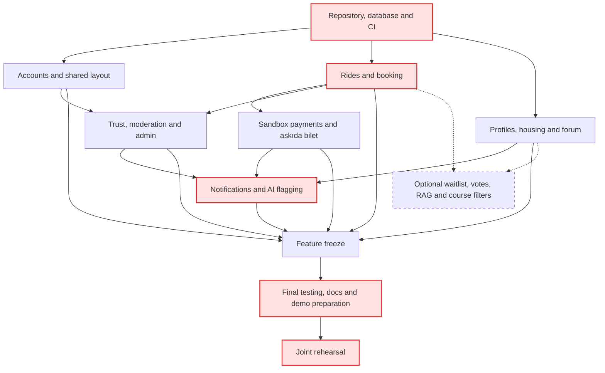

### 5.1 PERT Chart — Activity Sequence

The table lists technical dependencies and nominal durations at 7 hours per week. Actual calendar dates also include the availability in Section 4.3 and each member's activity order. **Feature freeze** requires every core feature (WBS-1.x–26.x, excluding optional work and the final phone-friendly check WBS-4.3). The chart highlights the revised resource-constrained critical chain; optional activities are dashed.

| WBS activity ID | Activity | Must wait for | Duration (weeks) |
|---|---|---|---|
| WBS-1.1 | Sign-up backend | WBS-27.2 | 0.48 |
| WBS-1.2 | Email code verification | WBS-1.1 | 0.48 |
| WBS-1.3 | Sign-up and verification pages | WBS-1.2, WBS-4.2 | 0.48 |
| WBS-2.1 | Login backend | WBS-27.2 | 0.48 |
| WBS-2.2 | Role checks | WBS-2.1 | 0.48 |
| WBS-2.3 | Login page | WBS-2.1, WBS-4.2 | 0.19 |
| WBS-3.1 | Profile backend | WBS-27.2 | 0.48 |
| WBS-3.2 | Profile pages | WBS-3.1, WBS-4.2 | 0.48 |
| WBS-4.1 | Frontend setup | WBS-28.1 | 0.19 |
| WBS-4.2 | Shared layout and components | WBS-4.1 | 0.95 |
| WBS-4.3 | Phone-friendly check | Feature freeze | 0.19 |
| WBS-5.1 | Trip backend | WBS-27.2 | 0.48 |
| WBS-5.2 | Trip posting pages | WBS-5.1, WBS-4.2 | 0.48 |
| WBS-6.1 | Search backend | WBS-5.1 | 0.48 |
| WBS-6.2 | Search and trip detail pages | WBS-6.1, WBS-4.2 | 0.95 |
| WBS-7.1 | Booking backend | WBS-5.1 | 0.95 |
| WBS-7.2 | Booking screens | WBS-7.1, WBS-6.2 | 0.48 |
| WBS-8.1 | Waitlist backend *(optional)* | WBS-7.1, WBS-22.1 | 0.48 |
| WBS-8.2 | Waitlist screens *(optional)* | WBS-8.1, WBS-7.2 | 0.19 |
| WBS-9.1 | Ride-ended backend | WBS-7.1 | 0.48 |
| WBS-9.2 | Ride-ended screens | WBS-9.1, WBS-7.2 | 0.19 |
| WBS-10.1 | Pay and hold (iyzico sandbox) | WBS-7.1, WBS-14.1 | 0.95 |
| WBS-10.2 | Release to driver | WBS-10.1, WBS-9.1 | 0.48 |
| WBS-10.3 | Payment screens | WBS-10.1, WBS-4.2 | 0.48 |
| WBS-11.1 | Refunds | WBS-10.1 | 0.48 |
| WBS-12.1 | Askıda bilet request backend | WBS-5.1 | 0.48 |
| WBS-12.2 | Request form and pool page | WBS-12.1, WBS-4.2 | 0.48 |
| WBS-13.1 | Anonymous donor payment | WBS-12.1, WBS-10.1 | 0.48 |
| WBS-13.2 | Donor payment screen | WBS-13.1, WBS-12.2 | 0.19 |
| WBS-14.1 | Ledger | WBS-27.2 | 0.48 |
| WBS-15.1 | Ride history and no-shows | WBS-9.1 | 0.48 |
| WBS-16.1 | Ratings backend | WBS-9.1 | 0.48 |
| WBS-16.2 | Rating screens | WBS-16.1, WBS-4.2 | 0.19 |
| WBS-17.1 | User reports | WBS-27.2, WBS-4.2 | 0.48 |
| WBS-18.1 | Room listing backend | WBS-27.2 | 0.48 |
| WBS-18.2 | Room listing pages | WBS-18.1, WBS-4.2 | 0.95 |
| WBS-19.1 | Forum backend | WBS-27.2 | 0.48 |
| WBS-19.2 | Forum pages | WBS-19.1, WBS-4.2 | 0.95 |
| WBS-19.3 | Course-code tags and filtering *(optional)* | WBS-19.1, WBS-19.2 | 0.48 |
| WBS-20.1 | Forum votes *(optional)* | WBS-19.2 | 0.48 |
| WBS-21.1 | Forum keyword search | WBS-19.2 | 0.48 |
| WBS-22.1 | Notification service | WBS-27.2 | 0.95 |
| WBS-22.2 | Connect events to notifications | WBS-22.1, WBS-7.1, WBS-9.1, WBS-10.1, WBS-13.1, WBS-19.1 | 0.48 |
| WBS-22.3 | Notification bell | WBS-22.1, WBS-4.2 | 0.48 |
| WBS-23.1 | AI provider setup | — (can start on day one) | 0.19 |
| WBS-23.2 | AI search backend *(optional)* | WBS-23.1, WBS-19.1 | 0.95 |
| WBS-23.3 | AI search box *(optional)* | WBS-23.2, WBS-19.2 | 0.19 |
| WBS-24.1 | AI content flagging | WBS-23.1, WBS-19.1, WBS-18.1, WBS-25.1 | 0.48 |
| WBS-25.1 | Moderation backend | WBS-17.1 | 0.95 |
| WBS-25.2 | Moderation pages | WBS-25.1 | 0.48 |
| WBS-26.1 | User and role management | WBS-2.2, WBS-4.2 | 0.48 |
| WBS-26.2 | Askıda bilet overview and statistics | WBS-14.1, WBS-12.1 | 0.48 |
| WBS-27.1 | Database design | — (can start on day one) | 0.95 |
| WBS-27.2 | Prisma setup and sample data | WBS-27.1, WBS-28.1 | 0.48 |
| WBS-28.1 | Repository setup | — (can start on day one) | 0.48 |
| WBS-28.2 | Automatic build and test (CI) | WBS-28.1 | 0.48 |
| WBS-28.3 | Speed and load checks | WBS-29.2, WBS-6.2, WBS-7.2, WBS-19.2 | 0.48 |
| WBS-28.4 | Testing on real phones | Feature freeze | 0.29 (longest member part) |
| WBS-29.1 | Cloud setup | WBS-28.1 | 0.95 |
| WBS-29.2 | Automatic deployment | WBS-29.1, WBS-28.2 | 0.48 |
| WBS-30.1 | Requirement Specification Report | — (can start on day one) | 0.67 (longest member part) |
| WBS-30.2 | Requirement Analysis Report | WBS-30.1 | 0.57 (longest member part) |
| WBS-30.3 | Software Design Report | WBS-30.2, WBS-27.1 | 0.29 (longest member part) |
| WBS-30.4 | Software Test Report | WBS-28.3, WBS-28.4 | 0.29 (longest member part) |
| WBS-31.1 | User guide | Feature freeze | 0.48 |
| WBS-31.2 | API documentation | Feature freeze | 0.19 (longest member part) |
| WBS-31.3 | Setup instructions | WBS-27.2, WBS-29.2 | 0.19 |
| WBS-32.1 | Demo script | WBS-30.2 | 0.48 |
| WBS-32.2 | Demo test data | WBS-32.1, WBS-29.2, Feature freeze | 0.48 |
| WBS-32.3 | Demo rehearsal | WBS-32.2, WBS-28.4 | 0.29 (longest member part) |
| WBS-33.1 | Presentation slides | WBS-32.1 | 0.95 |
| — | **Feature freeze (milestone)** | all core feature activities WBS-1.x–26.x, except optional work and WBS-4.3 | 0 |

**PERT notes:** Database and shared UI work enable feature development. Booking precedes payments and ride completion; the ledger precedes payments. Sample users unblock backend tests before authentication is ready. Final testing and documentation follow feature freeze; shared reports also follow their technical dependencies. Optional activities do not gate freeze or completion.

### 5.2 Critical Path and Total Project Duration

**Resource-constrained critical chain:**
`WBS-27.1 → WBS-27.2 → WBS-28.2 → WBS-29.2 → WBS-7.1 → WBS-7.2 → WBS-30.3 → WBS-26.2 → WBS-15.1 → WBS-32.1 → WBS-33.1 → WBS-24.1 → WBS-28.3 → WBS-28.4 → WBS-30.4 → WBS-32.2 → WBS-32.3`

Shared activities on this chain refer to Bünyamin's portions of WBS-30.3 and WBS-28.4, Ege's portion of WBS-30.4, and the whole team's rehearsal.

| Critical-chain segment | Forecast interval | Scheduling constraint |
|---|---|---|
| Database, Prisma and CI (27.1, 27.2, 28.2) | 26.10–08.11 | Enables deployment and feature backends |
| Bünyamin's sequence (29.2, 7.1, 7.2, 30.3, 26.2, 15.1, 32.1, 33.1, 24.1, 28.3, 28.4) | 08.11–23.12 | One activity at a time, with the listed availability |
| Ege's test-report share and demo data (30.4, 32.2) | 23.12–27.12 | Waits for all phone-testing shares to finish |
| Joint rehearsal (32.3) | 27.12–29.12 | Requires demo data and all members to be ready |

**Forecast:** feature freeze is **18.12.2026**; the final rehearsal finishes **29.12.2026 at 08:00**, approximately **9.2 weeks** after the start. Course deadlines remain **25.12** for the codebase, **26.12** for the demo and **28.12** for the presentation. The current sequence therefore has **no spare time** and exceeds the codebase deadline by **3.3 calendar days**; the previous 1.7-day buffer is consumed. The Software Test Report also finishes after its 21.12 deadline.

**Critical-path explanation:** an activity starts only when its dependencies are complete and its owner is free. The longest chain under those constraints sets the finish date. Aggregate capacity alone is insufficient: the current allocation and final testing dependencies require rebalancing and resequencing to restore a feasible baseline (R-11 and R-14).
